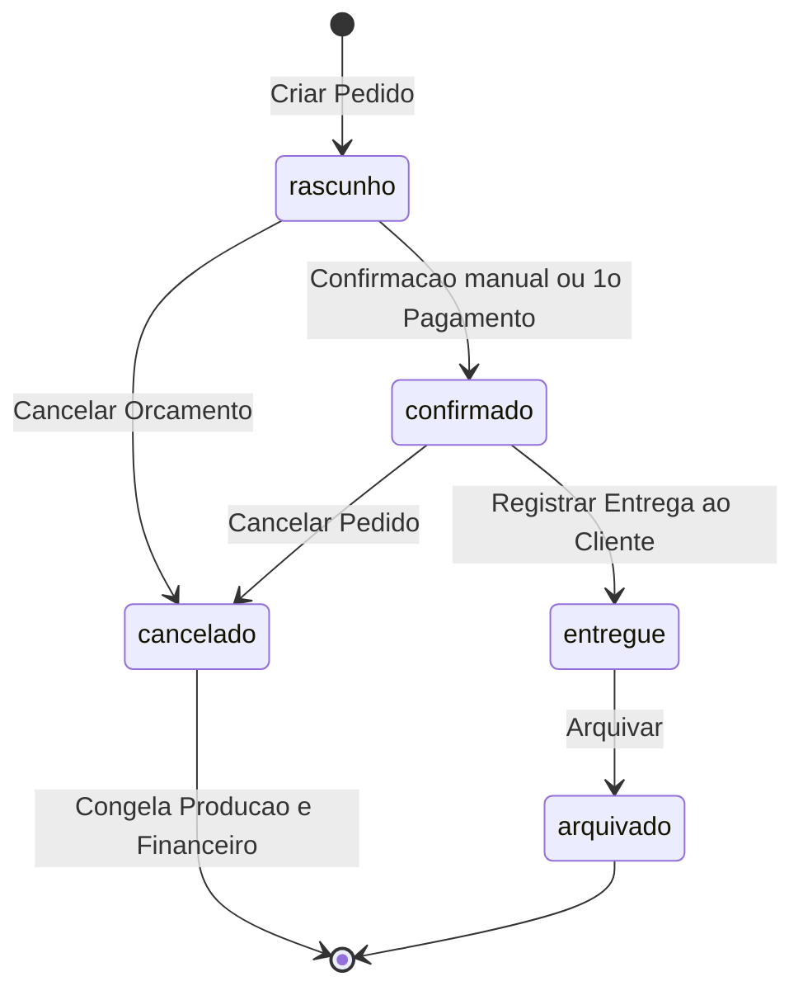
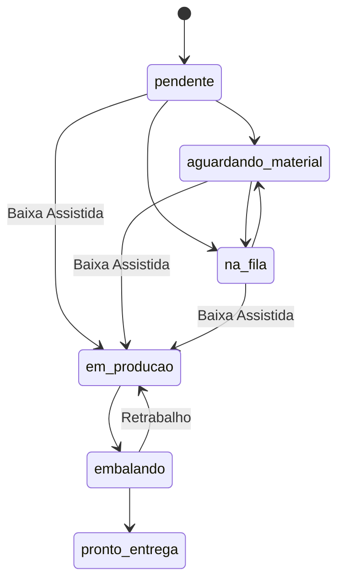

# Arquitetura Técnica — Sistema Atividros (V1.0)

> **Versão:** 1.0  
> **Status:** Baseline Arquitetural Aprovada para Design e Planejamento de Implementação  
> **Base Funcional:** `docs/PRD.md` (v2.0)  
> **Escopo:** Aplicação Web Responsiva Interna — Loja Única (Balcão + Oficina)

---

## 1. Visão Geral, Fronteiras e Vocabulário Canônico

### 1.1 Visão Arquitetural e Limites do Sistema

O **Atividros V1.0** é uma aplicação web monolítica modular composta por um **Backend REST assíncrono (FastAPI + SQLAlchemy 2.0)** e uma **SPA responsiva (React 19 + Vite)**, persistindo dados em **SQLite** (desenvolvimento/operação inicial) com portabilidade nativa para **PostgreSQL** (produção).

```text
+-----------------------------------------------------------------------+
|                    Clientes Web Responsivos (SPA)                     |
|   [Balcão / Desktop]  <-->  HTTP/JSON + Bearer JWT  <--> [Oficina]    |
+-----------------------------------+-----------------------------------+
                                    |
                          Proxy /api -> FastAPI
                                    |
+-----------------------------------v-----------------------------------+
|                   Backend Monolítico Modular (FastAPI)                |
|  - Autenticação JWT (app/api/autenticacao.py)                         |
|  - Motor Único de Cálculo (app/services/calculadora.py)               |
|  - Orquestração de Pedidos, Status, Pagamentos e Baixa Assistida      |
|  - Gestão de Estoque e Tabelas de Preço                               |
|  - Gerador de PDF Único (app/services/gerador_pdf.py via fpdf2)       |
+-----------------------------------+-----------------------------------+
                                    |
                       SQLAlchemy 2.0 Async + Alembic
                                    |
+-----------------------------------v-----------------------------------+
|             Banco Relacional (SQLite dev / PostgreSQL prod)           |
|  SequenciaNumeracao | Pedido/Item/Pagamento/Evento | Estoque/Preços   |
+-----------------------------------------------------------------------+
```

#### Limites Explícitos da V1.0 (O que NÃO faz parte desta arquitetura)
- **Uso exclusivo interno de loja única:** opera com 1 a 2 usuários simultâneos (balcão e oficina); **não** há multi-tenancy, isolamento de múltiplos clientes-empresa ou RBAC complexo na V1.0.
- **Aplicação 100% web responsiva:** **não** utiliza shell desktop nativo (como Tauri/Electron) nem runtime local separado.
- **Motor determinístico:** toda precificação e cálculo de medidas é 100% matemática e determinística; **não** há pipelines de IA/LLM, transcrição de áudio ou RAG.
- **Saída documental única:** gera exclusivamente **1 PDF unificado** (`Orçamento` ou `Pedido / Ordem de Serviço`); **não** exporta PPTX ou DOCX.
- **Sem integrações externas na V1.0:** sem integração com WhatsApp, emissão fiscal (NF-e/NFC-e) ou serviços externos em nuvem.

### 1.2 Domínios e Responsabilidades

| Domínio | Responsabilidade Principal | Limites na V1.0 |
|---|---|---|
| **Autenticação e Segurança** | Emissão/validação de JWT (`HS256`), proteção de 100% das rotas de negócio e sanitização de logs/CORS. | Usuário interno único/compartilhado sem RBAC granular nem refresh token rotativo. |
| **Estoque e Tabelas de Preço** | Controle de molduras por barra inteira, vidros e fundos por `m²` (`Decimal`), suplementos manuais e tabelas editáveis de preço (`Vidro`, `Fundo`, `Paspatour`). | Sem plano de corte de chapas ou gestão de retalhos aproveitáveis. |
| **Calculadora Unificada** | Cálculo determinístico de propagação de dimensões, perda 45°, área mínima, insumos e valor sugerido para quadros e vidros avulsos. | Preços de referência vêm do banco; sobreescrita comercial ocorre apenas no contexto do pedido. |
| **Pedidos, Financeiro e Auditoria** | Ciclo de vida em 3 eixos independentes, numeração sequencial persistida, múltiplos pagamentos (`PagamentoPedido`), baixa assistida de estoque e trilha imutável (`PedidoEvento`). | Sem contas a pagar, fluxo de caixa contábil ou estorno automático em gateway externo. |
| **Clientes e Dashboard** | Cadastro de clientes com histórico filtrado no servidor e painel operacional com alertas de prazo, receita confirmada e ruptura de estoque. | Sem portal externo para o cliente final. |
| **Documentos (PDF)** | Geração síncrona em memória de PDF único adaptável ao status (`rascunho` vs. `confirmado`+). | Sem armazenamento permanente de binários PDF no disco/S3. |

### 1.3 Vocabulário Canônico

| Termo Canônico | Definição Oficial no Domínio Atividros |
|---|---|
| **Obra** | Peça original do cliente (gravura, tela, foto, espelho base) medida em `altura × largura` (cm), ponto de partida da propagação dimensional. |
| **Paspatour** | Borda interna decorativa aplicada ao redor da obra (`tamanho_paspatour` em cm por lado), expandindo a medida interna do vidro e do fundo (`+ 2 × tamanho_paspatour`). |
| **Moldura** | Perfil em barra cadastrado no estoque por comprimento (`tamanho_barra` em m), largura da face (`largura_barra` em cm), estoque em barras inteiras (`quantidade`) e preço por metro (`R$/m`). Um quadro aceita `0..N` molduras ordenadas de dentro para fora. |
| **Chapa** | Unidade física de entrada para **Vidro** ou **Fundo**. Na entrada de estoque, suas dimensões (`qtd × L_cm × A_cm / 10000`) são convertidas automaticamente para saldo em `m²` (`area_disponivel_m2`). |
| **Suplemento** | Insumo acessório de oficina (cola, grampos, fita, penduradores, embalagem) controlado de forma **100% manual** no módulo de estoque, sem baixa automática em pedidos. |
| **Quadro sob medida** | Tipo de `ItemPedido` (`quadro_sob_medida`) originado da Calculadora Unificada, contendo composição completa (obra, paspatour, vidro, fundo, `0..N` molduras, mão de obra) e *snapshot* técnico imutável. |
| **Vidro avulso** | Tipo de `ItemPedido` (`vidro_avulso`) para corte reto sob medida (`largura × altura`), precificado pela `TabelaPrecoVidro` com regra de área mínima (`area_cobrada_m2`) e baixa opcional em `m²` reais no `Vidro` selecionado. |
| **Serviço livre** | Tipo de `ItemPedido` (`servico_livre`) com descrição, quantidade e preço unitário informados manualmente (ex.: troca de vidro, instalação, quadro pronto), sem vínculo obrigatório com cálculo de corte. |
| **Orçamento / Rascunho** | Pedido com `status_geral = rascunho` e `data_validade_orcamento`. Permite edição irrestrita de itens e valores e não compõe a receita confirmada do Dashboard. |
| **Baixa Assistida** | Operação transacional executada ao mover a produção para `em_producao`: exibe quantidades sugeridas (barras de moldura e `m²` reais de vidro/fundo), permite ajuste manual de barras e confirma débito mesmo em ruptura (saldo negativo permitido com alerta). |
| **PedidoEvento** | Registro imutável de auditoria (`append-only`) gravado a cada criação de pedido, transição de status, lançamento/estorno de pagamento e baixa de estoque. |
| **Snapshot de Cálculo** | Fotografia JSON imutável persistida em `ItemPedido.snapshot_calculo` (e detalhada em `ItemPedidoMoldura`) no momento da gravação do item, preservando dimensões por camada, consumo e preços vigentes mesmo se o estoque ou tabelas mudarem depois. |

---

## 2. Registro de Decisões Arquiteturais (ADRs)

| ID | Decisão | Status |
|---|---|---|
| **ADR-001** | Unidade padrão de `preco_custo` das molduras em **R$/m** (paridade com `preco_venda`) | Aprovada |
| **ADR-002** | Padrão de entrada e cálculo de `mao_de_obra` em **R$ por unidade** | Aprovada |
| **ADR-003** | Desacoplamento de tabela de preço vs. item físico de estoque para **Vidro**, **Fundo** e **Paspatour** | Aprovada |
| **ADR-004** | Persistência híbrida de composição: tabela ordenada **`ItemPedidoMoldura` + `snapshot_calculo` JSON** | Aprovada |
| **ADR-005** | Numeração sequencial `YYYYNNNNN` via tabela **`SequenciaNumeracao` com incremento atômico** compatível com SQLite e PostgreSQL | Aprovada |
| **ADR-006** | Padronização de hash de senha em **`pbkdf2_sha256`** e proteção integral de rotas via JWT `HS256` | Aprovada |
| **ADR-007** | **Motor único de cálculo determinístico** no backend (`services/calculadora.py`), removendo `/calculadora/simular` legado | Aprovada |
| **ADR-008** | Controle de chapas (Vidro e Fundo) em **`area_disponivel_m2` (`Numeric(12, 4)`)** com baixa assistida não-bloqueante | Aprovada |
| **ADR-009** | **PDF Único** (`fpdf2`) com cabeçalho contextual (`ORÇAMENTO` vs. `PEDIDO / OS`) e ocultação de `valor_sugerido` | Aprovada |

### ADR-001 — Unidade padrão de `preco_custo` das molduras (`R$/m`)
- **Contexto:** O `PRD.md` (§3.2.A) define `preco_venda` das molduras explicitamente em `R$/m`, deixando em aberto se `preco_custo` deve ser armazenado em `R$/m` ou `R$/barra`. No código atual (`backend/app/models/estoque.py:24-25`), ambos são `Numeric(10, 2)` na mesma entidade ao lado de `tamanho_barra` (m). Todos os testes existentes (`tests/test_baixa_estoque.py:11`, `test_calculadora_quadro.py:73`, `test_estoque.py:14-15`) usam pares proporcionais como `preco_venda=50.00` e `preco_custo=25.00` para barras de `3.0 m` (margem de 50% por metro; caso fosse R$/barra, R$ 25,00/3m equivaleria a R$ 8,33/m).
- **Decisão:** Padronizar `Moldura.preco_custo` e `Moldura.preco_venda` ambos em **R$/m** (reais por metro linear). Como conveniência opcional de interface, o formulário de estoque pode oferecer um campo auxiliar *"Informar custo da barra (R$)"* que divide pelo `tamanho_barra` antes de enviar `preco_custo` em `R$/m` para a API.
- **Alternativas descartadas:** Armazenar `preco_custo` em `R$/barra` (exigiria conversão constante em relatórios de margem por metro e contradiz a massa de testes atual); armazenar uma enum `unidade_custo` por moldura (complexidade desnecessária para V1.0).
- **Consequências:** Comparação direta de custo vs. venda na mesma unidade (`R$/m`); schemas e labels de UI (`Estoque.jsx`) devem exibir explicitamente `(R$/m)`.

### ADR-002 — Padrão de entrada e cálculo de `mao_de_obra` (`R$ por unidade`)
- **Contexto:** O `PRD.md` (§3.3) deixa aberto se `mao_de_obra` é informada por unidade ou como valor fixo total do item. No backend atual (`backend/app/services/calculadora.py:93-97`), todos os custos unitários são calculados para 1 quadro e multiplicados por `quantidade` ao final (`total * quantidade`), e no `ItemPedido` (`models/pedido.py:67-69`) o contrato é estritamente `subtotal = preco_unitario * quantidade`. No frontend (`Calculadora.jsx:179-183`), o resultado destaca o valor unitário quando `quantidade > 1`.
- **Decisão:** Padronizar `mao_de_obra` como **R$ por unidade** do item. Ela integra o `valor_sugerido` unitário do quadro (`valor_sugerido_unitario = soma_materiais_unitario + mao_de_obra`) e escala multiplicada por `quantidade`.
- **Alternativas descartadas:** `mao_de_obra` como valor fixo diluído no lote (quebra `subtotal = preco_unitario * quantidade` com dízimas periódicas caso o usuário altere a `quantidade` diretamente no pedido, além de exigir campo separado de rateio).
- **Consequências:** Coerência matemática entre Calculadora e `ItemPedido`; alteração de `quantidade` no pedido mantém o preço unitário íntegro sem recálculo fracionário.

### ADR-003 — Seleção de preço vs. estoque físico para Vidro, Fundo e Paspatour
- **Contexto:** No código atual (`schemas/calculadora.py:38`), a calculadora recebe apenas `vidro_tipo: str` (para buscar `TabelaPrecoVidro`), não identificando qual `Vidro` físico do estoque será baixado posteriormente. Para Paspatour (`services/calculadora.py:130`), o código faz `select(TabelaPrecoPaspatour).limit(1)`, ignorando múltiplos registros cadastrados. Para Fundo (`services/calculadora.py:140`), usa `Decimal("30.0")` hardcoded sem tabela de preço.
- **Decisão:**
  1. **Vidro:** A Calculadora e os itens `quadro_sob_medida`/`vidro_avulso` aceitam `vidro_tipo` (obrigatório quando houver vidro, chave de consulta em `TabelaPrecoVidro`) **e** `vidro_id` (opcional, apontando para a chapa em `Vidro` quando o material sairá do estoque na baixa assistida).
  2. **Fundo:** Criar `TabelaPrecoFundo` (`tipo` único, `preco_por_m2`, `descricao`). Na Calculadora/Item, aceitar `fundo_tipo` (ou derivado do `fundo_id` selecionado) e `fundo_id` opcional para baixa física em `Fundo`. Se `fundo_id` for informado sem `fundo_tipo`, o motor resolve `TabelaPrecoFundo` pelo `Fundo.tipo`.
  3. **Paspatour:** Exigir `paspatour_id` (FK opcional para `TabelaPrecoPaspatour`) quando `paspatour == True`, eliminando o `limit(1)` implícito (se omitido em cliente legado durante transição, retorna erro de validação 422 quando houver mais de uma opção, ou seleciona a única existente se houver apenas 1 registro).
- **Alternativas descartadas:** Unificar tabela de preço dentro da entidade de estoque (`Vidro`/`Fundo`) — descartado pois o `PRD.md` (§3.2.D) exige tabelas de preço editáveis por categoria (`incolor`, `espelho`, `MDF`, etc.), independentes de variações de cor/espessura ou compra sob encomenda sem saldo prévio.
- **Consequências:** Permite orçar materiais mesmo sem chapa cadastrada no estoque (`vidro_id = None` / `fundo_id = None`) e garante baixa exata na chapa correta quando vinculada.

### ADR-004 — Persistência híbrida de múltiplas molduras (`ItemPedidoMoldura` + `snapshot_calculo`)
- **Contexto:** O `ItemPedido` atual (`models/pedido.py:71`) possui apenas `moldura_id` único e não suporta múltiplas molduras ordenadas nem guarda medidas intermediárias (obra, vidro, moldura 1..N, quadro final). O `PRD.md` (§5) sugere `ItemPedidoMoldura` ou composição JSON/relacional com snapshot.
- **Decisão:** Adotar um **modelo híbrido relacional + snapshot**:
  - **Tabela filha `ItemPedidoMoldura`:** armazena de forma relacional e ordenada (`ordem` `0..N-1`) cada moldura aplicada ao item, com `moldura_id` (FK), `codigo_moldura_snapshot`, `largura_barra_cm`, `tamanho_barra_m`, `preco_m_aplicado`, `altura_calculada_cm`, `largura_calculada_cm`, `metragem_total_m` e `barras_sugeridas`.
  - **Coluna `ItemPedido.snapshot_calculo` (JSON):** armazena o objeto completo imutável retornado pelo motor de cálculo no momento da criação/edição do item (dimensões por camada, áreas reais/cobradas, preços aplicados, consumos unitários e totais).
- **Alternativas descartadas:** JSON puro sem tabela filha (dificulta integridade referencial de `moldura_id` e queries diretas de baixa de estoque); dezenas de colunas avulsas em `ItemPedido` (inviável para `0..N` molduras).
- **Consequências:** A Baixa Assistida lê diretamente `ItemPedidoMoldura` + `ItemPedido.vidro_id`/`fundo_id` com integridade referencial garantida, enquanto o PDF e a visualização histórica do pedido leem `snapshot_calculo` sem sofrer mutação caso o usuário edite preços ou larguras no estoque posteriormente.

### ADR-005 — Estratégia de numeração sequencial segura (`SequenciaNumeracao`)
- **Contexto:** O código atual (`services/pedido.py:39-46`) usa `NUMERO_COUNTER = {"valor": 1}` em RAM com ano fixo `2026`, colidindo após reinício do servidor. O sistema roda em SQLite em desenvolvimento/piloto e migrará para PostgreSQL em produção.
- **Decisão:** Criar a tabela `sequencia_numeracao (ano INTEGER PRIMARY KEY, ultimo_valor INTEGER NOT NULL)` e gerar `numero_pedido` no formato `YYYYNNNNN` utilizando instrução SQL atômica única `INSERT INTO sequencia_numeracao (ano, ultimo_valor) VALUES (:ano, 1) ON CONFLICT (ano) DO UPDATE SET ultimo_valor = sequencia_numeracao.ultimo_valor + 1 RETURNING ultimo_valor` dentro da transação de criação do pedido (com `BEGIN IMMEDIATE` no SQLite para evitar `SQLITE_BUSY` sob concorrência de escrita e retry controlado em lock transitório). Detalhamento completo na Seção 4.
- **Alternativas descartadas:** `SELECT MAX(numero_pedido) + 1` (vulnerável a *race condition* se dois pedidos forem criados simultaneamente e vulnerável a reutilização de número após exclusão de rascunho); `CREATE SEQUENCE` nativo do PostgreSQL (incompatível com SQLite e exige reinicialização anual por DDL).
- **Consequências:** Portabilidade idêntica entre SQLite (3.35+) e PostgreSQL, zero colisões entre reinícios, numeração monotonicamente crescente por ano e independente de exclusão de rascunhos.

### ADR-006 — Algoritmo de hash de senha (`pbkdf2_sha256`) e política de autenticação
- **Contexto:** `services/autenticacao.py:17` já utiliza `CryptContext(schemes=["pbkdf2_sha256"], deprecated="auto")`, enquanto `pyproject.toml:18` lista `passlib[bcrypt] ^1.7.4`. No Python 3.12+, `passlib 1.7.4` com versões recentes da lib `bcrypt` (>= 4.1) apresenta incompatibilidade conhecida de introspecção (`__about__`) e truncamento silencioso em 72 bytes, ao passo que `pbkdf2_sha256` funciona nativamente dentro do próprio `passlib` sem dependência C externa e já gera todos os hashes dos testes atuais.
- **Decisão:** Padronizar **`pbkdf2_sha256`** como algoritmo oficial de hash de senha na V1.0 (configurando mínimo recomendado de rounds do `passlib` e removendo o extra `[bcrypt]` não utilizado do `pyproject.toml` para evitar falhas de build/runtime em Python 3.12+), mantendo JWT `HS256` com expiração configurável (`minutos_expiracao_token`), `Depends(obter_usuario_atual)` em **100% das rotas de negócio** (exceções únicas: `GET /` e `POST /autenticacao/entrar`), remoção imediata de log de senha (`autenticacao.py:22`) e restrição de CORS via `CORS_ORIGINS`.
- **Alternativas descartadas:** Adotar `bcrypt` com pinagem artificial `bcrypt<4.1` (adiciona fragilidade de empacotamento sem ganho prático para 1–2 usuários internos); introduzir refresh token e RBAC (fora do escopo V1.0 no `PRD.md`).
- **Consequências:** Zero quebra com hashes existentes no ambiente de desenvolvimento/testes, build determinístico em Python 3.12+ e fechamento completo dos débitos #4, #5 e #6 do PRD.

### ADR-007 — Unificação do Motor de Cálculo no Backend
- **Contexto:** Hoje existem 3 endpoints (`/calculadora/quadro`, `/calculadora/` e `/calculadora/simular`) com duas implementações divergentes (`services/calculadora.py` vs. `services/pedido.py:obter_detalhes_calculo` com vidro hardcoded R$ 100 e fundo R$ 30).
- **Decisão:** Consolidar toda a regra de negócio no módulo `app/services/calculadora.py` e expor os endpoints `POST /calculadora/quadro` (quadro sob medida) e `POST /calculadora/vidro-avulso` (corte simples com regra de área mínima), **removendo** `/calculadora/` e `/calculadora/simular` e a função `obter_detalhes_calculo` de `services/pedido.py`. Ao criar/atualizar `ItemPedido` do tipo `quadro_sob_medida` ou `vidro_avulso`, o serviço de pedidos invoca o mesmo motor único de cálculo para gerar `valor_sugerido` e o `snapshot_calculo`.
- **Alternativas descartadas:** Manter `/calculadora/simular` como alias depreciado (mantém dívida técnica e risco de divergência de preço entre telas).
- **Consequências:** Fonte única da verdade para dimensões, perda 45°, área mínima, `TabelaPrecoFundo` e consumos.

### ADR-008 — Estoque de chapas (Vidro e Fundo) em `m²` e Baixa Assistida não-bloqueante
- **Contexto:** Os modelos atuais de `Vidro` e `Fundo` armazenam `quantidade: int`, `largura_chapa`, `altura_chapa` e a baixa atual subtrai 1 chapa inteira por quadro, bloqueando com HTTP 400 se saldo insuficiente. O `PRD.md` (§3.2.B e §3.4) exige saldo contínuo em `m²`, conversor de entrada por chapas e baixa assistida não-bloqueante.
- **Decisão:** Substituir `quantidade`/`largura_chapa`/`altura_chapa` em `Vidro` e `Fundo` por `area_disponivel_m2: Numeric(12, 4)` (aceitando valores negativos após baixa) e `estoque_minimo_m2: Numeric(12, 4)`. Criar endpoints dedicados de entrada por chapas (`qtd × L × A / 10000`) e ajuste manual de `m²`. Na baixa de estoque do pedido (transição para `em_producao`), permitir ajuste manual de barras de moldura e debitar `area_real_m2 × quantidade` para vidros/fundos vinculados, **sem bloquear** em caso de saldo insuficiente, retornando lista de rupturas na resposta e registrando em `PedidoEvento`.
- **Alternativas descartadas:** Baixar chapas inteiras ou bloquear produção sem estoque (impraticável no dia a dia da oficina, conforme `PRD.md:168`).
- **Consequências:** Controle fiel ao consumo real de vidraçaria/molduraria; dashboards e relatórios devem tratar saldos `< 0` como alerta crítico prioritário.

### ADR-009 — PDF Único (`fpdf2`) com contexto por status
- **Contexto:** O `gerador_pdf.py` atual gera sempre o mesmo título, ignora `item.descricao`, omite medidas técnicas por camada, frete, desconto, pagamentos, saldo devedor e assinatura.
- **Decisão:** Manter `fpdf2` (já maduro no `pyproject.toml`, sem exigir dependências de sistema pesado como Chromium/WeasyPrint no Windows/Linux) evoluindo `GeradorPDFPedido` em `app/services/gerador_pdf.py` para renderizar o **PDF Único** adaptável: título `ORÇAMENTO` + `data_validade_orcamento` quando `status_geral == rascunho`; `PEDIDO / ORDEM DE SERVIÇO` + `prazo_entrega` quando `status_geral in ["confirmado", "entregue", "arquivado"]`; e `PEDIDO CANCELADO` (tarja destacada, omitindo `prazo_entrega` e sem `Saldo Devedor` como cobrança ativa) quando `status_geral == cancelado`. Inclui exibição completa das camadas técnicas do `snapshot_calculo`, resumo financeiro adequado ao status e **proibição absoluta** de imprimir `valor_sugerido` ou alertas internos de margem.
- **Alternativas descartadas:** WeasyPrint/Playwright (sobrecarga operacional de bibliotecas GTK/browser para servidor simples de loja única).
- **Consequências:** Geração rápida em memória (< 100 ms por pedido), zero dependência nativa externa e documento único servindo balcão, cliente e oficina.

---

## 3. Modelo de Dados Remodelado

### 3.1 Diagrama Entidade-Relacionamento (DER)

```mermaid
erDiagram
    USUARIO {
        int id PK
        string nome_usuario UK
        string senha_hash
        string nome_completo
        bool esta_ativo
        datetime criado_em
    }
    CLIENTE {
        int id PK
        string nome
        string sobrenome
        string telefone IDX
        string email
        string endereco
        string cep
        datetime criado_em
    }
    MOLDURA {
        int id PK
        string codigo UK
        int quantidade
        int estoque_minimo
        decimal preco_venda
        decimal preco_custo
        string cor
        decimal tamanho_barra
        decimal largura_barra
        string marca
    }
    VIDRO {
        int id PK
        enum tipo
        decimal espessura
        string cor
        decimal area_disponivel_m2
        decimal estoque_minimo_m2
    }
    FUNDO {
        int id PK
        string tipo
        decimal espessura
        string cor
        decimal area_disponivel_m2
        decimal estoque_minimo_m2
    }
    SUPLEMENTO {
        int id PK
        string nome UK
        int quantidade
        string unidade
    }
    TABELA_PRECO_VIDRO {
        int id PK
        string tipo UK
        decimal preco_por_m2
        decimal area_minima_m2
        string descricao
    }
    TABELA_PRECO_FUNDO {
        int id PK
        string tipo UK
        decimal preco_por_m2
        string descricao
    }
    TABELA_PRECO_PASPATOUR {
        int id PK
        string descricao
        decimal preco_por_m2
    }
    SEQUENCIA_NUMERACAO {
        int ano PK
        int ultimo_valor
    }
    PEDIDO {
        int id PK
        int cliente_id FK
        string numero_pedido UK
        enum status_geral
        enum status_producao
        enum status_financeiro
        date data_validade_orcamento
        date prazo_entrega
        string endereco_entrega
        decimal frete
        decimal desconto_valor
        enum desconto_tipo
        decimal subtotal_itens
        decimal valor_total
        decimal valor_pago
        decimal saldo_devedor
        string observacoes
        datetime criado_em
        datetime atualizado_em
    }
    ITEM_PEDIDO {
        int id PK
        int pedido_id FK
        enum tipo_item
        string descricao
        int quantidade
        decimal valor_sugerido
        decimal preco_unitario
        decimal subtotal
        decimal obra_largura
        decimal obra_altura
        bool paspatour
        decimal tamanho_paspatour
        int paspatour_id FK
        int vidro_id FK
        string vidro_tipo
        int fundo_id FK
        string fundo_tipo
        decimal mao_de_obra
        json snapshot_calculo
    }
    ITEM_PEDIDO_MOLDURA {
        int id PK
        int item_pedido_id FK
        int moldura_id FK
        int ordem
        string codigo_moldura_snapshot
        decimal largura_barra_cm
        decimal tamanho_barra_m
        decimal preco_m_aplicado
        decimal altura_calculada_cm
        decimal largura_calculada_cm
        decimal metragem_total_m
        int barras_sugeridas
    }
    PAGAMENTO_PEDIDO {
        int id PK
        int pedido_id FK
        decimal valor
        enum forma_pagamento
        datetime data_pagamento
        string observacao
        bool estornado
        datetime criado_em
    }
    PEDIDO_EVENTO {
        int id PK
        int pedido_id FK
        enum eixo
        string status_anterior
        string status_novo
        string observacao
        datetime criado_em
    }

    CLIENTE ||--o{ PEDIDO : "possui"
    PEDIDO ||--|{ ITEM_PEDIDO : "contem"
    PEDIDO ||--o{ PAGAMENTO_PEDIDO : "recebe"
    PEDIDO ||--o{ PEDIDO_EVENTO : "registra"
    ITEM_PEDIDO ||--o{ ITEM_PEDIDO_MOLDURA : "compoe"
    MOLDURA ||--o{ ITEM_PEDIDO_MOLDURA : "referenciada_em"
    VIDRO ||--o{ ITEM_PEDIDO : "consumido_em"
    FUNDO ||--o{ ITEM_PEDIDO : "consumido_em"
    TABELA_PRECO_PASPATOUR ||--o{ ITEM_PEDIDO : "precifica"
```

### 3.2 Especificação das Tabelas, Tipos `Numeric/Decimal`, Índices e Constraints

> **Regra de precisão numérica:** Todo valor monetário usa `Numeric(12, 2)` (ou `Numeric(10, 2)` em tabelas unitárias) mapeado em Python para `decimal.Decimal` (nunca `float`); medidas lineares em cm/m usam `Numeric(10, 2)` e áreas em `m²` / metragens de consumo usam `Numeric(12, 4)` para evitar desvios acumulados em multiplicações de chapas.

#### A. Identidade e Clientes

1. **`usuarios`**
   - `id`: `Integer`, PK
   - `nome_usuario`: `String(50)`, `UNIQUE`, `INDEX`, `NOT NULL`
   - `senha_hash`: `String(255)`, `NOT NULL`
   - `nome_completo`: `String(100)`, `NULL`
   - `esta_ativo`: `Boolean`, `NOT NULL`, default `True`
   - `criado_em`: `DateTime(timezone=True)`, `NOT NULL`, default UTC

2. **`clientes`**
   - `id`: `Integer`, PK
   - `nome`: `String(100)`, `NOT NULL`, `INDEX` (`ix_clientes_nome_sobrenome`)
   - `sobrenome`: `String(100)`, `NOT NULL`
   - `telefone`: `String(20)`, `NOT NULL`, `INDEX`
   - `email`: `String(120)`, `NULL`, `INDEX`
   - `endereco`: `String(255)`, `NULL`
   - `cep`: `String(20)`, `NULL`
   - `criado_em`: `DateTime(timezone=True)`, `NOT NULL`, default UTC

#### B. Estoque e Tabelas de Preço

3. **`molduras`**
   - `id`: `Integer`, PK
   - `codigo`: `String(50)`, `UNIQUE`, `INDEX`, `NOT NULL`
   - `cor`: `String(50)`, `NOT NULL`
   - `marca`: `String(100)`, `NULL`
   - `tamanho_barra`: `Numeric(10, 2)`, `NOT NULL`, `CHECK (tamanho_barra > 0)` *(metros)*
   - `largura_barra`: `Numeric(10, 2)`, `NOT NULL`, `CHECK (largura_barra > 0)` *(cm)*
   - `preco_custo`: `Numeric(10, 2)`, `NOT NULL`, `CHECK (preco_custo >= 0)` *(R$/m — ADR-001)*
   - `preco_venda`: `Numeric(10, 2)`, `NOT NULL`, `CHECK (preco_venda >= 0)` *(R$/m)*
   - `quantidade`: `Integer`, `NOT NULL`, default `0` *(barras inteiras; **pode ser negativo** após baixa em ruptura)*
   - `estoque_minimo`: `Integer`, `NOT NULL`, default `5`, `CHECK (estoque_minimo >= 0)`

4. **`vidros`**
   - `id`: `Integer`, PK
   - `tipo`: `Enum(TipoVidro)` (`incolor`, `antireflexo`, `espelho`, `outro`), `NOT NULL`, `INDEX`
   - `espessura`: `Numeric(10, 2)`, `NOT NULL`, `CHECK (espessura > 0)` *(mm)*
   - `cor`: `String(50)`, `NULL`
   - `area_disponivel_m2`: `Numeric(12, 4)`, `NOT NULL`, default `0.0000` *(permite saldo negativo pós-baixa)*
   - `estoque_minimo_m2`: `Numeric(12, 4)`, `NOT NULL`, default `2.0000`, `CHECK (estoque_minimo_m2 >= 0)`
   - *Constraint sugerida:* índice composto não-exclusivo `(tipo, espessura, cor)` para listagem ordenada.

5. **`fundos`**
   - `id`: `Integer`, PK
   - `tipo`: `String(50)`, `NOT NULL`, `INDEX` *(ex.: `MDF`, `Eucatex`, `Foam Board`)*
   - `espessura`: `Numeric(10, 2)`, `NOT NULL`, `CHECK (espessura > 0)` *(mm)*
   - `cor`: `String(50)`, `NULL`
   - `area_disponivel_m2`: `Numeric(12, 4)`, `NOT NULL`, default `0.0000` *(permite saldo negativo pós-baixa)*
   - `estoque_minimo_m2`: `Numeric(12, 4)`, `NOT NULL`, default `2.0000`, `CHECK (estoque_minimo_m2 >= 0)`

6. **`suplementos`**
   - `id`: `Integer`, PK
   - `nome`: `String(100)`, `UNIQUE`, `NOT NULL`
   - `quantidade`: `Integer`, `NOT NULL`, default `0`, `CHECK (quantidade >= 0)`
   - `unidade`: `String(20)`, `NULL` *(ex.: `un`, `ml`, `kg`, `cx`)*

7. **`tabela_preco_vidro`**
   - `id`: `Integer`, PK
   - `tipo`: `String(50)`, `UNIQUE`, `NOT NULL` *(alinhado aos valores de `TipoVidro`)*
   - `preco_por_m2`: `Numeric(10, 2)`, `NOT NULL`, `CHECK (preco_por_m2 >= 0)`
   - `area_minima_m2`: `Numeric(10, 4)`, `NOT NULL`, default `0.2500`, `CHECK (area_minima_m2 >= 0)`
   - `descricao`: `String(255)`, `NULL`

8. **`tabela_preco_fundo`** *(nova)*
   - `id`: `Integer`, PK
   - `tipo`: `String(50)`, `UNIQUE`, `NOT NULL` *(correspondência case-insensitive/normalizada com `Fundo.tipo`)*
   - `preco_por_m2`: `Numeric(10, 2)`, `NOT NULL`, `CHECK (preco_por_m2 >= 0)`
   - `descricao`: `String(255)`, `NULL`

9. **`tabela_preco_paspatour`**
   - `id`: `Integer`, PK
   - `descricao`: `String(255)`, `UNIQUE`, `NOT NULL`
   - `preco_por_m2`: `Numeric(10, 2)`, `NOT NULL`, `CHECK (preco_por_m2 >= 0)`

#### C. Pedidos, Itens, Pagamentos, Auditoria e Sequência

10. **`sequencia_numeracao`** *(nova)*
    - `ano`: `Integer`, PK
    - `ultimo_valor`: `Integer`, `NOT NULL`, `CHECK (ultimo_valor >= 0)`

11. **`pedidos`**
    - `id`: `Integer`, PK
    - `cliente_id`: `Integer`, `FK -> clientes.id (ON DELETE RESTRICT)`, `NOT NULL`, `INDEX`
    - `numero_pedido`: `String(20)`, `UNIQUE`, `NOT NULL`, `INDEX` *(formato `YYYYNNNNN`, imutável)*
    - `status_geral`: `Enum(StatusGeral)` (`rascunho`, `confirmado`, `entregue`, `arquivado`, `cancelado`), `NOT NULL`, default `rascunho`, `INDEX`
    - `status_producao`: `Enum(StatusProducao)` (`pendente`, `aguardando_material`, `na_fila`, `em_producao`, `embalando`, `pronto_entrega`), `NOT NULL`, default `pendente`, `INDEX`
    - `status_financeiro`: `Enum(StatusFinanceiro)` (`sem_pagamento`, `pagamento_parcial`, `pago_total`, `estornado`), `NOT NULL`, default `sem_pagamento`, `INDEX`
    - `data_validade_orcamento`: `Date`, `NULL` *(preenchida automaticamente com `hoje + 7 dias` na criação de `rascunho` se não informada)*
    - `prazo_entrega`: `Date`, `NULL`, `INDEX`
    - `endereco_entrega`: `String(255)`, `NULL`
    - `frete`: `Numeric(12, 2)`, `NOT NULL`, default `0.00`, `CHECK (frete >= 0)`
    - `desconto_valor`: `Numeric(12, 2)`, `NOT NULL`, default `0.00`, `CHECK (desconto_valor >= 0)`
    - `desconto_tipo`: `Enum(TipoDesconto)` (`valor`, `percentual`), `NOT NULL`, default `valor`
    - `subtotal_itens`: `Numeric(12, 2)`, `NOT NULL`, default `0.00`
    - `valor_total`: `Numeric(12, 2)`, `NOT NULL`, default `0.00`
    - `valor_pago`: `Numeric(12, 2)`, `NOT NULL`, default `0.00`
    - `saldo_devedor`: `Numeric(12, 2)`, `NOT NULL`, default `0.00`
    - `observacoes`: `Text`, `NULL`
    - `criado_em`: `DateTime(timezone=True)`, `NOT NULL`, default UTC, `INDEX`
    - `atualizado_em`: `DateTime(timezone=True)`, `NOT NULL`, default UTC, `onupdate` UTC

12. **`itens_pedido`** *(remodelada)*
    - `id`: `Integer`, PK
    - `pedido_id`: `Integer`, `FK -> pedidos.id (ON DELETE CASCADE)`, `NOT NULL`, `INDEX`
    - `tipo_item`: `Enum(TipoItemPedido)` (`quadro_sob_medida`, `vidro_avulso`, `servico_livre`), `NOT NULL`
    - `descricao`: `String(500)`, `NOT NULL`
    - `quantidade`: `Integer`, `NOT NULL`, default `1`, `CHECK (quantidade >= 1)`
    - `valor_sugerido`: `Numeric(12, 2)`, `NOT NULL`, default `0.00` *(valor unitário sugerido pelo motor; uso interno, **nunca** exibido no PDF)*
    - `preco_unitario`: `Numeric(12, 2)`, `NOT NULL`, `CHECK (preco_unitario >= 0)` *(valor praticado após eventual edição livre)*
    - `subtotal`: `Numeric(12, 2)`, `NOT NULL`, `CHECK (subtotal >= 0)` *(`preco_unitario * quantidade`)*
    - `obra_largura`: `Numeric(10, 2)`, `NULL` *(cm; obrigatório para `quadro_sob_medida` e `vidro_avulso`)*
    - `obra_altura`: `Numeric(10, 2)`, `NULL` *(cm; obrigatório para `quadro_sob_medida` e `vidro_avulso`)*
    - `paspatour`: `Boolean`, `NOT NULL`, default `False`
    - `tamanho_paspatour`: `Numeric(10, 2)`, `NOT NULL`, default `0.00`, `CHECK (tamanho_paspatour >= 0)`
    - `paspatour_id`: `Integer`, `FK -> tabela_preco_paspatour.id (ON DELETE SET NULL)`, `NULL`
    - `vidro_id`: `Integer`, `FK -> vidros.id (ON DELETE RESTRICT)`, `NULL` *(referência de estoque para baixa)*
    - `vidro_tipo`: `String(50)`, `NULL` *(referência à `TabelaPrecoVidro.tipo`)*
    - `fundo_id`: `Integer`, `FK -> fundos.id (ON DELETE RESTRICT)`, `NULL` *(referência de estoque para baixa)*
    - `fundo_tipo`: `String(50)`, `NULL` *(referência à `TabelaPrecoFundo.tipo`)*
    - `mao_de_obra`: `Numeric(12, 2)`, `NOT NULL`, default `0.00`, `CHECK (mao_de_obra >= 0)` *(R$/unidade)*
    - `snapshot_calculo`: `JSON`, `NULL` *(snapshot completo imutável para `quadro_sob_medida` e `vidro_avulso`)*

13. **`itens_pedido_moldura`** *(nova)*
    - `id`: `Integer`, PK
    - `item_pedido_id`: `Integer`, `FK -> itens_pedido.id (ON DELETE CASCADE)`, `NOT NULL`, `INDEX`
    - `moldura_id`: `Integer`, `FK -> molduras.id (ON DELETE RESTRICT)`, `NOT NULL`
    - `ordem`: `Integer`, `NOT NULL`, `CHECK (ordem >= 0)` *(0 = mais interna)*
    - `codigo_moldura_snapshot`: `String(50)`, `NOT NULL`
    - `largura_barra_cm`: `Numeric(10, 2)`, `NOT NULL`
    - `tamanho_barra_m`: `Numeric(10, 2)`, `NOT NULL`
    - `preco_m_aplicado`: `Numeric(10, 2)`, `NOT NULL`
    - `altura_calculada_cm`: `Numeric(10, 2)`, `NOT NULL`
    - `largura_calculada_cm`: `Numeric(10, 2)`, `NOT NULL`
    - `metragem_total_m`: `Numeric(12, 4)`, `NOT NULL` *(consumo unitário já com perda 45°)*
    - `barras_sugeridas`: `Integer`, `NOT NULL` *(`ceil((metragem_total_m * item.quantidade) / tamanho_barra_m)`)*
    - `UNIQUE (item_pedido_id, ordem)`

14. **`pagamentos_pedido`** *(nova)*
    - `id`: `Integer`, PK
    - `pedido_id`: `Integer`, `FK -> pedidos.id (ON DELETE CASCADE)`, `NOT NULL`, `INDEX`
    - `valor`: `Numeric(12, 2)`, `NOT NULL`, `CHECK (valor > 0)`
    - `forma_pagamento`: `Enum(FormaPagamento)` (`pix`, `cartao_credito`, `cartao_debito`, `dinheiro`, `outro`), `NOT NULL`
    - `data_pagamento`: `DateTime(timezone=True)`, `NOT NULL`, default UTC
    - `observacao`: `String(255)`, `NULL`
    - `estornado`: `Boolean`, `NOT NULL`, default `False`
    - `criado_em`: `DateTime(timezone=True)`, `NOT NULL`, default UTC

15. **`pedidos_eventos`**
    - `id`: `Integer`, PK
    - `pedido_id`: `Integer`, `FK -> pedidos.id (ON DELETE CASCADE)`, `NOT NULL`, `INDEX`
    - `eixo`: `Enum(Eixo)` (`geral`, `producao`, `financeiro`, `estoque`), `NOT NULL`
    - `status_anterior`: `String(50)`, `NULL`
    - `status_novo`: `String(50)`, `NOT NULL`
    - `observacao`: `Text`, `NULL` *(armazena também detalhamento de materiais na baixa de estoque)*
    - `criado_em`: `DateTime(timezone=True)`, `NOT NULL`, default UTC, `INDEX`

### 3.3 Mapeamento Explícito de Migração (`models/*.py` Atuais → V1.0) e Correções do Alembic

Como o sistema encontra-se em **pré-lançamento sem usuários em produção** (`PRD.md`, cabeçalho), recomenda-se gerar uma migração limpa de consolidação V1.0 (ou migração incremental explícita caso queira preservar massa local de dev) aplicando as transformações abaixo:

| Arquivo Atual | Alterações Necessárias na V1.0 |
|---|---|
| `backend/app/models/estoque.py` | **Moldura:** adicionar `estoque_minimo` (default `5`). **Vidro:** remover `quantidade`, `largura_chapa`, `altura_chapa`; adicionar `area_disponivel_m2` e `estoque_minimo_m2`. **Fundo:** remover `quantidade`, `largura`, `altura`; adicionar `area_disponivel_m2` e `estoque_minimo_m2`. |
| `backend/app/models/tabela_preco.py` | **TabelaPrecoVidro:** adicionar `area_minima_m2` (default `0.2500`). **TabelaPrecoFundo:** criar nova tabela. **TabelaPrecoPaspatour:** adicionar `UNIQUE(descricao)`. |
| `backend/app/models/pedido.py` | **Enums:** remover `entregue` e renomear `para_embalar`→`embalando` + incluir `na_fila` em `StatusProducao`; trocar `sinal_recebido`→`pagamento_parcial` em `StatusFinanceiro`; adicionar `estoque` em `Eixo`; criar `TipoItemPedido`, `TipoDesconto`, `FormaPagamento`. **Pedido:** remover `valor_sinal`; adicionar `data_validade_orcamento`, `prazo_entrega`, `desconto_valor`, `desconto_tipo`, `subtotal_itens`, `valor_pago`, `observacoes`. **ItemPedido:** remover `moldura_id`, `largura`, `altura`; adicionar `tipo_item`, `valor_sugerido`, `obra_largura`, `obra_altura`, `paspatour`, `tamanho_paspatour`, `paspatour_id`, `vidro_tipo`, `fundo_tipo`, `mao_de_obra`, `snapshot_calculo`. **Novas classes:** `ItemPedidoMoldura`, `PagamentoPedido`, `SequenciaNumeracao`. |
| `backend/migrations/env.py` | **Bug atual (L10-15):** não importa `TabelaPrecoVidro` nem `TabelaPrecoPaspatour`, e lê URL fixa de `alembic.ini:89`. **Correção:** importar **todos** os módulos/modelos (`usuario`, `cliente`, `estoque`, `tabela_preco`, `pedido`) e configurar `config.set_main_option("sqlalchemy.url", settings.database_url)` no `env.py`, incluindo `render_as_batch=True` no `context.configure(...)` para suportar `ALTER TABLE` no SQLite. |
| `backend/pyproject.toml` | Adicionar driver assíncrono PostgreSQL (`asyncpg ^0.30.0`) para permitir migração e execução imediata em produção PostgreSQL; remover extra `[bcrypt]` não utilizado (ADR-006). |
| `.gitignore` | Remover a linha indevida `/backend/migrations/versions/baf432e819f5_adicionando_modelos_de_pedidos.py` (L210) e ignorar `*.db` / `*.sqlite*` (removendo `backend/test_atividros.db` do versionamento). |

---

## 4. Regras de Negócio, Motor de Cálculo e Máquinas de Estado

### 4.1 Motor Único de Cálculo Determinístico (`app/services/calculadora.py`)

Elimina completamente `/calculadora/`, `/calculadora/simular` e `services/pedido.py:obter_detalhes_calculo`. Toda operação matemática usa `decimal.Decimal` com quantização explícita (`ROUND_HALF_UP`): `0.01` para valores monetários (`R$`) e dimensões (`cm`), e `0.0001` para áreas (`m²`) e metragens (`m`).

#### Caso A: Quadro Sob Medida (`quadro_sob_medida`)

**Entradas:** `obra_altura` (>0), `obra_largura` (>0), `quantidade` (≥1), `paspatour` (bool), `tamanho_paspatour` (≥0), `paspatour_id` (obrigatório se `paspatour=True`), `molduras` (lista ordenada `0..N` de `{moldura_id, ordem}`), `vidro_tipo` (opcional), `vidro_id` (opcional), `fundo_id` (opcional), `fundo_tipo` (opcional), `mao_de_obra` (≥0, em `R$/unidade`).

**Sequência Passo a Passo:**
1. **Obra:**
   - `altura_obra = obra_altura`
   - `largura_obra = obra_largura`
2. **Vidro / Paspatour / Fundo (Propagação Interna):**
   - Se `paspatour == True` e `tamanho_paspatour > 0`:
     - `altura_vidro = altura_obra + (2 × tamanho_paspatour)`
     - `largura_vidro = largura_obra + (2 × tamanho_paspatour)`
   - Caso contrário:
     - `altura_vidro = altura_obra`
     - `largura_vidro = largura_obra`
   - `area_real_m2 = (altura_vidro × largura_vidro) / 10000`
3. **Propagação das Molduras (da interna `i=0` para a externa `i=N-1`):**
   - Inicializa `altura_atual = altura_vidro`, `largura_atual = largura_vidro`.
   - Para cada moldura `i` ordenada por `ordem`:
     - `altura_i = altura_atual + (2 × largura_barra_i)`
     - `largura_i = largura_atual + (2 × largura_barra_i)`
     - `perimetro_seco_i = 2 × (altura_i + largura_i) / 100` *(em metros)*
     - `perda_45_i = (8 × largura_barra_i) / 100` *(4 cantos em esquadria 45°, em metros)*
     - `metragem_total_i = perimetro_seco_i + perda_45_i`
     - `subtotal_moldura_i = round_2(metragem_total_i × preco_venda_i)`
     - `barras_sugeridas_i = ceil((metragem_total_i × quantidade) / tamanho_barra_i)`
     - Atualiza `altura_atual = altura_i`, `largura_atual = largura_i`.
4. **Quadro Final:**
   - `altura_final = altura_atual`, `largura_final = largura_atual` *(coincide com a moldura mais externa, ou com vidro/obra se `N = 0`)*.
5. **Precificação dos Demais Materiais (Unitários):**
   - **Vidro** *(se `vidro_tipo` informado)*:
     - Busca `TabelaPrecoVidro` por `tipo == vidro_tipo`.
     - `area_cobrada_vidro_m2 = max(area_real_m2, tabela_vidro.area_minima_m2)`
     - `subtotal_vidro = round_2(area_cobrada_vidro_m2 × tabela_vidro.preco_por_m2)`
     - *(Consumo de estoque na baixa usará `area_real_m2 × quantidade`, nunca `area_cobrada_vidro_m2`.)*
   - **Paspatour** *(se `paspatour == True`)*:
     - Busca `TabelaPrecoPaspatour` por `paspatour_id`.
     - `subtotal_paspatour = round_2(area_real_m2 × tabela_paspatour.preco_por_m2)`
   - **Fundo** *(se `fundo_id` ou `fundo_tipo` informado)*:
     - Resolve `tipo_efetivo`: se `fundo_id` informado, obtém `Fundo.tipo` (e valida existência); senão usa `fundo_tipo`.
     - Busca `TabelaPrecoFundo` por `tipo == tipo_efetivo`.
     - `area_fundo_m2 = area_real_m2` *(acompanha a medida do vidro / interna da moldura, **não** a medida da obra)*.
     - `subtotal_fundo = round_2(area_fundo_m2 × tabela_fundo.preco_por_m2)`
   - **Mão de Obra:** `subtotal_mao_de_obra = round_2(mao_de_obra)` *(por unidade)*.
6. **Totais do Item:**
   - `valor_sugerido_unitario = round_2(subtotal_paspatour + subtotal_vidro + sum(subtotal_moldura_i) + subtotal_fundo + subtotal_mao_de_obra)`
   - `total_sugerido = round_2(valor_sugerido_unitario × quantidade)`

#### Caso B: Vidro / Espelho Avulso (`vidro_avulso`)
- `altura_vidro = obra_altura`, `largura_vidro = obra_largura` (sem paspatour, sem moldura, sem fundo).
- `area_real_m2 = (altura_vidro × largura_vidro) / 10000`.
- `area_cobrada_m2 = max(area_real_m2, tabela_vidro.area_minima_m2)`.
- `valor_sugerido_unitario = round_2(area_cobrada_m2 × tabela_vidro.preco_por_m2 + mao_de_obra)`.
- `total_sugerido = round_2(valor_sugerido_unitario × quantidade)`.

#### Regra de Edição Livre de Preço e Totais do Pedido
- Na inclusão/edição do `ItemPedido`, o backend calcula e persiste `valor_sugerido` (unitário). O usuário pode enviar qualquer `preco_unitario >= 0`.
- Se `preco_unitario < valor_sugerido` (ou `total_final < total_sugerido`), o backend **aceita e salva normalmente** (regra não-bloqueante), retornando o campo derivado booleano `abaixo_do_sugerido: true` na resposta JSON para que o frontend exiba o alerta visual amarelo interno. `valor_sugerido` **jamais** é renderizado no PDF.
- Totais do `Pedido` (calculados exclusivamente no backend):
  - `subtotal_itens = sum(item.subtotal)` onde `item.subtotal = round_2(item.preco_unitario × item.quantidade)`
  - Se `desconto_tipo == "valor"`: `desconto_calculado = desconto_valor`
  - Se `desconto_tipo == "percentual"`: `desconto_calculado = round_2((subtotal_itens × desconto_valor) / 100)` *(validado `0 <= desconto_valor <= 100`)*
  - `valor_total = max(Decimal("0.00"), round_2(subtotal_itens + frete - desconto_calculado))`
  - `valor_pago = sum(p.valor for p in pagamentos if not p.estornado)`
  - `saldo_devedor = max(Decimal("0.00"), round_2(valor_total - valor_pago))`

---

### 4.2 Máquinas de Estado — 3 Eixos Independentes (Saneados)

#### Eixo 1: Status Geral (`status_geral`) — Ciclo de Vida Comercial



- **Regras do Eixo 1:**
  - `rascunho`: estado inicial; edição completa permitida (`PUT /pedidos/{id}`).
  - `rascunho → confirmado`: manual (`PATCH /pedidos/{id}/status`) ou **automática** ao lançar o primeiro `PagamentoPedido` válido sobre um pedido em `rascunho`. Ao confirmar um pedido com `valor_total == 0` (ex.: desconto de 100%) e sem pagamentos estornados, o `status_financeiro` deriva automaticamente para `pago_total`.
  - `confirmado → entregue`: registra entrega efetiva ao cliente (não existe mais `entregue` no eixo de produção).
  - `rascunho | confirmado → cancelado`: **congela** imediatamente os eixos de Produção e Financeiro para novas movimentações de avanço (impedindo novos pagamentos ou avanço/baixa de produção). Se `valor_pago > 0`, a resposta e o `PedidoEvento` registram alerta explícito de **estorno pendente/necessário**, permanecendo liberado o endpoint `POST /pedidos/{id}/pagamentos/{pag_id}/estornar` para regularização financeira dos pagamentos lançados.

#### Eixo 2: Status de Produção (`status_producao`) — Fluxo da Oficina



- **Estados válidos (sem `entregue` duplicado):** `pendente`, `aguardando_material`, `na_fila`, `em_producao`, `embalando`, `pronto_entrega`.
- **Bloqueio por congelamento:** se `status_geral == cancelado` ou `status_geral == arquivado`, transições de produção são rejeitadas com HTTP 400.
- **Transição para `em_producao`:** deve ocorrer **exclusivamente** via endpoint `POST /pedidos/{id}/baixa-estoque` (Baixa Assistida) a partir de `pendente`, `aguardando_material` ou `na_fila` — o `PATCH /pedidos/{id}/status` rejeita transição direta para `em_producao` sem passar pela Baixa Assistida.

#### Eixo 3: Status Financeiro (`status_financeiro`) — Derivado de `PagamentoPedido`

| Estado | Regra de Derivação Automática | Observação |
|---|---|---|
| `sem_pagamento` | `valor_pago == 0` quando nunca houve pagamento válido (`len(pagamentos) == 0`) e `valor_total > 0` (ou `status_geral == "rascunho"`, inclusive se cancelado diretamente como orçamento) | Estado inicial; orçamento com desconto 100% aguarda confirmação |
| `pagamento_parcial` | `0 < valor_pago < valor_total` | Substitui o antigo `sinal_recebido` |
| `pago_total` | `valor_pago >= valor_total` quando `valor_total > 0`, **ou** `valor_total == 0` quando `status_geral in ["confirmado", "entregue", "arquivado"]` e sem pagamentos estornados (`len(pagamentos) == 0`) | Quitação completa (inclui pedido confirmado com 100% de desconto e `saldo_devedor == 0`) |
| `estornado` | `valor_pago == 0` quando existiu ao menos um pagamento lançado (`len(pagamentos) > 0`) e todos foram marcados como `estornado = True` | Aplicável em cancelamento/devolução ou estorno total |

- **Regra crítica:** O `status_financeiro` **não é alterado manualmente** via `PATCH /status`; ele é sempre recalculado de forma determinística pelo serviço de pagamentos em `POST /pedidos/{id}/pagamentos`, `POST /pedidos/{id}/pagamentos/{pag_id}/estornar` (inclusive em pedidos `confirmado`, `entregue` ou `cancelado`) e na confirmação comercial (`rascunho → confirmado`) quando `valor_total == 0`.

---

### 4.3 Fluxo Transacional da Baixa de Estoque Assistida

1. **Pré-visualização (`GET /pedidos/{id}/previsao-baixa`):**
   - Valida **`status_geral == "confirmado"`** (bloqueando explicitamente `rascunho`, `entregue`, `cancelado` e `arquivado` com **`400 Bad Request`**) e `status_producao in ["pendente", "aguardando_material", "na_fila"]`.
   - Agrupa por `moldura_id` todas as entradas de `ItemPedidoMoldura` dos itens do pedido: exibe `barras_sugeridas`, `estoque_atual_barras` e `saldo_projetado`.
   - Agrupa por `vidro_id` e `fundo_id` as áreas reais (`area_real_m2 × quantidade`) calculadas no `snapshot_calculo`: exibe `area_a_baixar_m2`, `area_disponivel_m2` e `saldo_projetado_m2`.
   - Indica `em_ruptura: true/false` para cada material cujo `saldo_projetado < 0`.
   - **Caso sem insumos físicos vinculados** (ex.: pedido composto apenas por `servico_livre`, ou itens sem `moldura_id`/`vidro_id`/`fundo_id`): retorna listas vazias (`molduras: []`, `vidros: []`, `fundos: []`) com a flag `possui_insumos_estoque: false`.
2. **Confirmação (`POST /pedidos/{id}/baixa-estoque`):**
   - Valida **`status_geral == "confirmado"`** (bloqueando explicitamente `rascunho`, `entregue`, `cancelado` e `arquivado` com **`400 Bad Request`**) e `status_producao in ["pendente", "aguardando_material", "na_fila"]`.
   - Recebe mapa opcional `ajustes_molduras: [{ moldura_id, barras_baixadas }]` (inteiros `>= 0`; se omitido para alguma moldura, usa a soma de `barras_sugeridas`).
   - Executa tudo em **uma única transação atômica**:
     - Quando houver insumos físicos (`possui_insumos_estoque == true`):
       - Debita `moldura.quantidade -= barras_baixadas`.
       - Debita `vidro.area_disponivel_m2 -= area_real_total_m2` (para itens com `vidro_id` vinculado).
       - Debita `fundo.area_disponivel_m2 -= area_real_total_m2` (para itens com `fundo_id` vinculado).
       - **Não bloqueia** se qualquer saldo ficar `< 0`; coleta lista `alertas_ruptura` com os materiais negativos.
     - Quando **não** houver insumos físicos vinculados (ex.: apenas `servico_livre`, `possui_insumos_estoque == false`): conclui a transição para `em_producao` sem realizar débitos de estoque.
     - Atualiza `pedido.status_producao = StatusProducao.em_producao`, gravando o `status_anterior` real (corrige o bug atual que hardcodava `pendente`).
     - Registra `PedidoEvento(eixo=Eixo.producao, status_anterior=status_prod_anterior, status_novo="em_producao", ...)` — e, quando houver movimentação de materiais, `PedidoEvento(eixo=Eixo.estoque, status_anterior=status_prod_anterior, status_novo="baixa_realizada", observacao=<resumo detalhado>)` — além de log estruturado no backend.

### 4.4 Conversor de Entrada de Chapas e Ajuste Manual (`Vidro` e `Fundo`)

- **Entrada por Chapas:** usuário informa `quantidade_chapas` (`int >= 1`), `largura_cm` (`Decimal > 0`) e `altura_cm` (`Decimal > 0`).
  - `area_adicionada_m2 = round_4((quantidade_chapas × largura_cm × altura_cm) / 10000)`
  - `area_disponivel_m2 += area_adicionada_m2`
- **Ajuste Manual de Inventário:** usuário informa `nova_area_m2` (`Decimal`, pode ser `>= 0` ou negativo para correção de inventário) ou `delta_m2`, atualizando diretamente `area_disponivel_m2` com log operacional.

---

## 5. Estratégia de Numeração Sequencial Segura (SQLite + PostgreSQL)

Substitui integralmente `NUMERO_COUNTER` em RAM (`backend/app/services/pedido.py:39-46`).

### 5.1 Formato e Imutabilidade
- Formato: **`YYYYNNNNN`** (ex.: `202600001`, `202600002`, ..., `202700001`), onde `YYYY` é o ano corrente no fuso da loja (`America/Sao_Paulo` ou UTC configurado) e `NNNNN` tem zero-padding de 5 dígitos (`:05d`, expandindo naturalmente se ultrapassar 99.999 no mesmo ano).
- Gerado **exclusivamente** no `POST /pedidos/` dentro da transação de persistência e **imutável** por toda a vida do pedido.
- Exclusão de um rascunho (`DELETE /pedidos/{id}`) **não** retrocede a sequência, garantindo ausência de reutilização de identificadores em documentos/PDFs já emitidos ao cliente.

### 5.2 Mecanismo Atômico Dual-Engine (SQLite e PostgreSQL)

A tabela `sequencia_numeracao (ano INTEGER PRIMARY KEY, ultimo_valor INTEGER NOT NULL)` é atualizada via **UPSERT atômico com `RETURNING`**, compatível tanto com SQLite (`>= 3.35`, Python 3.12 embute `3.45+`) quanto com PostgreSQL (`>= 9.5`):

```sql
INSERT INTO sequencia_numeracao (ano, ultimo_valor)
VALUES (:ano, 1)
ON CONFLICT (ano) DO UPDATE
SET ultimo_valor = sequencia_numeracao.ultimo_valor + 1
RETURNING ultimo_valor;
```

#### Comportamento por Banco e Tratamento de Concorrência
1. **PostgreSQL (Produção):** O comando `INSERT ... ON CONFLICT DO UPDATE` adquire lock exclusivo na linha `(ano)` durante o statement dentro da transação do pedido. Dois workers paralelos nunca obtêm o mesmo `ultimo_valor`; o segundo aguarda o commit/rollback do primeiro e lê o valor incrementado.
2. **SQLite (Desenvolvimento / Loja Local):**
   - Configurar `PRAGMA busy_timeout = 5000;` e `PRAGMA journal_mode = WAL;` na conexão SQLite (`app/db/session.py` via event listener `connect`).
   - Iniciar a transação de criação do pedido com `BEGIN IMMEDIATE` quando o dialeto for `sqlite`, garantindo aquisição imediata do write-lock antes do `UPSERT` e evitando deadlocks de upgrade `SHARED → RESERVED`.
   - Em caso residual de `OperationalError` (`database is locked`), aplicar retry exponencial curto (máx. 3 tentativas: 50ms, 100ms, 200ms) no serviço de criação de pedido antes da persistência.
3. **Virada de Ano:** Quando `ano` muda (ex.: `2026` → `2027`), a cláusula `INSERT ... VALUES (2027, 1)` insere automaticamente a nova linha do ano corrente iniciando em `202700001` sem exigir cronjob ou intervenção manual.

---

## 6. Contratos REST Completos (Backend FastAPI)

### 6.1 Matriz de Proteção de Rotas (`Depends(obter_usuario_atual)`)

**Regra absoluta (`PRD.md` §3.1):** **100% das rotas de negócio são protegidas** por JWT (`Authorization: Bearer <token>`), retornando `401 Unauthorized` quando ausente/inválido.

| Grupo | Rotas | Autenticação | Observação |
|---|---|---|---|
| Saúde | `GET /` | Pública | Healthcheck mínimo (sem dados sensíveis) |
| Autenticação | `POST /autenticacao/entrar` | Pública | Login via `OAuth2PasswordRequestForm`; **zero log de senha** |
| Autenticação | `GET /autenticacao/me` | **Obrigatória** | Perfil do usuário logado |
| Clientes | Todas (`/clientes/*`) | **Obrigatória** | Inclui `GET /clientes/?q=` e `GET /clientes/{id}/pedidos` |
| Estoque | Todas (`/estoque/*`) | **Obrigatória** | Corrige Débito #6: todos os `GET` agora exigem auth |
| Calculadora & Tabelas | Todas (`/calculadora/*`) | **Obrigatória** | Corrige Débito #6: `GET tabela-vidro/fundo/paspatour` exigem auth |
| Pedidos, Pagamentos, Baixa, PDF | Todas (`/pedidos/*`) | **Obrigatória** | Inclui PDF, eventos, previsão e baixa de estoque |
| Dashboard | `GET /dashboard/resumo` | **Obrigatória** | KPIs operacionais e alertas de estoque |

### 6.2 Catálogo Consolidado de Endpoints

| Módulo | Método e Rota | Propósito | Status HTTP Sucesso |
|---|---|---|---|
| **Saúde** | `GET /` | Healthcheck da API | `200 OK` |
| **Auth** | `POST /autenticacao/entrar` | Autenticar usuário e emitir JWT | `200 OK` |
| **Auth** | `GET /autenticacao/me` | Dados do usuário autenticado | `200 OK` |
| **Clientes** | `GET /clientes/` | Listar/buscar clientes (`?q=`) | `200 OK` |
| **Clientes** | `POST /clientes/` | Criar cliente | `201 Created` |
| **Clientes** | `GET /clientes/{id}` | Obter cliente | `200 OK` |
| **Clientes** | `PUT /clientes/{id}` | Atualizar cliente (com normalização de strings vazias) | `200 OK` |
| **Clientes** | `DELETE /clientes/{id}` | Excluir cliente (bloqueia se possuir pedidos: `409 Conflict`) | `204 No Content` |
| **Clientes** | `GET /clientes/{id}/pedidos` | Histórico de pedidos do cliente no servidor | `200 OK` |
| **Estoque** | `GET /estoque/molduras` | Listar molduras (`?q=`, `?critico=true`) | `200 OK` |
| **Estoque** | `POST/PUT/DELETE /estoque/molduras[/{id}]` | CRUD de molduras (`R$/m`, `estoque_minimo`; `DELETE` retorna `409 Conflict` se vinculada a itens de pedido) | `201`/`200`/`204` |
| **Estoque** | `GET /estoque/vidros`, `GET /estoque/vidros/{id}` | Listar/obter vidros (`area_disponivel_m2`) | `200 OK` |
| **Estoque** | `POST/PUT/DELETE /estoque/vidros[/{id}]` | CRUD de vidros (`DELETE` retorna `409 Conflict` se vinculado a itens de pedido) | `201`/`200`/`204` |
| **Estoque** | `POST /estoque/vidros/{id}/entrada-chapas` | Registrar entrada por chapas (`qtd × L × A / 10000`) | `200 OK` |
| **Estoque** | `POST /estoque/vidros/{id}/ajuste-m2` | Ajuste manual direto de `area_disponivel_m2` | `200 OK` |
| **Estoque** | `GET /estoque/fundos`, `GET /estoque/fundos/{id}` | Listar/obter fundos (`area_disponivel_m2`) | `200 OK` |
| **Estoque** | `POST/PUT/DELETE /estoque/fundos[/{id}]` | CRUD de fundos (`DELETE` retorna `409 Conflict` se vinculado a itens de pedido) | `201`/`200`/`204` |
| **Estoque** | `POST /estoque/fundos/{id}/entrada-chapas` | Registrar entrada de chapas de fundo | `200 OK` |
| **Estoque** | `POST /estoque/fundos/{id}/ajuste-m2` | Ajuste manual direto de `area_disponivel_m2` | `200 OK` |
| **Estoque** | `GET/POST/PUT/DELETE /estoque/suplementos[/{id}]` | CRUD manual de suplementos | `200`/`201`/`204` |
| **Calculadora** | `POST /calculadora/quadro` | Motor único de cálculo de quadro sob medida | `200 OK` |
| **Calculadora** | `POST /calculadora/vidro-avulso` | Cálculo determinístico de vidro/espelho avulso | `200 OK` |
| **Preços** | `GET/POST/PUT/DELETE /calculadora/tabela-vidro[/{id}]` | CRUD da tabela de preços de vidro (`area_minima_m2`) | `200`/`201`/`204` |
| **Preços** | `GET/POST/PUT/DELETE /calculadora/tabela-fundo[/{id}]` | CRUD da tabela de preços de fundo *(nova)* | `200`/`201`/`204` |
| **Preços** | `GET/POST/PUT/DELETE /calculadora/tabela-paspatour[/{id}]` | CRUD da tabela de preços de paspatour | `200`/`201`/`204` |
| **Pedidos** | `GET /pedidos/` | Listar pedidos (`?cliente_id=`, `?status_geral=`, `?status_producao=`, `?q=`) | `200 OK` |
| **Pedidos** | `POST /pedidos/` | Criar pedido/orçamento com numeração atômica e snapshot | `201 Created` |
| **Pedidos** | `GET /pedidos/{id}` | Detalhar pedido completo (itens, molduras, pagamentos, eventos) | `200 OK` |
| **Pedidos** | `PUT /pedidos/{id}` | Editar pedido em `rascunho` | `200 OK` |
| **Pedidos** | `DELETE /pedidos/{id}` | Excluir pedido em `rascunho` ou `cancelado` (sem pagamentos ativos) | `204 No Content` |
| **Pedidos** | `PATCH /pedidos/{id}/status` | Transição de status nos eixos `geral` e `producao` (exceto `em_producao`) | `200 OK` |
| **Pagamentos** | `GET /pedidos/{id}/pagamentos` | Listar lançamentos de pagamento do pedido | `200 OK` |
| **Pagamentos** | `POST /pedidos/{id}/pagamentos` | Registrar pagamento parcial/total (pode confirmar `rascunho`) | `201 Created` |
| **Pagamentos** | `POST /pedidos/{id}/pagamentos/{pag_id}/estornar` | Estornar pagamento lançado (recalcula `valor_pago` e status) | `200 OK` |
| **Produção** | `GET /pedidos/{id}/previsao-baixa` | Calcular previsão de consumo (barras e m²) + flags de ruptura (exige `status_geral == confirmado`) | `200 OK` |
| **Produção** | `POST /pedidos/{id}/baixa-estoque` | Confirmar baixa assistida e mover para `em_producao` (exige `status_geral == confirmado`) | `200 OK` |
| **Auditoria** | `GET /pedidos/{id}/eventos` | Linha do tempo cronológica de `PedidoEvento` | `200 OK` |
| **Documento** | `GET /pedidos/{id}/pdf` | Download do PDF Único (`application/pdf`) | `200 OK` |
| **Dashboard** | `GET /dashboard/resumo` | KPIs financeiros, prazos e alertas de estoque crítico | `200 OK` |

### 6.3 Detalhamento dos Contratos Críticos (Request / Response / Validações)

#### 1. `POST /autenticacao/entrar`
- **Request:** `application/x-www-form-urlencoded` (`username`, `password`).
- **Response `200 OK`:**
  ```json
  { "token_acesso": "<jwt>", "tipo_token": "bearer" }
  ```
- **Erros:** `401` (`"Usuário ou senha incorretos"`), `403` (`"Usuário inativo"`).

#### 2. `GET /clientes/?q=` e `GET /clientes/{id}/pedidos`
- `GET /clientes/?q=silva`: busca case-insensitive (`ILIKE` / `LIKE`) em `nome`, `sobrenome`, `telefone` e `email`.
- `GET /clientes/{id}/pedidos`: retorna `list[RespostaPedidoResumo]` ordenado por `criado_em DESC`; `404` se cliente inexistente. Corrige o bug do `Clientes.jsx` que carregava todos os pedidos no navegador.
- `AtualizarCliente`: aplica `empty_str_to_none` também em `email`, `endereco` e `cep` no schema de atualização (corrige falha de validação em `PUT`).

#### 3. `POST /estoque/vidros/{id}/entrada-chapas` e `POST /estoque/fundos/{id}/entrada-chapas`
- **Request:**
  ```json
  { "quantidade_chapas": 3, "largura_cm": "240.00", "altura_cm": "180.00" }
  ```
- **Validações Pydantic:** `quantidade_chapas: int >= 1`, `largura_cm > 0`, `altura_cm > 0`.
- **Response `200 OK`:**
  ```json
  {
    "id": 1,
    "area_adicionada_m2": "12.9600",
    "area_disponivel_m2": "18.4600"
  }
  ```

#### 4. `POST /estoque/vidros/{id}/ajuste-m2` e `POST /estoque/fundos/{id}/ajuste-m2`
- **Request:** `{ "nova_area_m2": "15.2500", "motivo": "Inventário físico" }` (ou `motivo` opcional).
- **Response `200 OK`:** entidade atualizada (`RespostaVidro` / `RespostaFundo`).

#### 5. `POST /calculadora/quadro` (Motor Unificado)
- **Request (`EntradaCalculoQuadro`):**
  ```json
  {
    "obra_largura": "50.00",
    "obra_altura": "40.00",
    "quantidade": 2,
    "paspatour": true,
    "tamanho_paspatour": "5.00",
    "paspatour_id": 1,
    "molduras": [
      { "moldura_id": 3, "ordem": 0 },
      { "moldura_id": 7, "ordem": 1 }
    ],
    "vidro_tipo": "incolor",
    "vidro_id": 2,
    "fundo_id": 1,
    "fundo_tipo": "MDF",
    "mao_de_obra": "25.00"
  }
  ```
- **Validações Pydantic:**
  - `obra_largura > 0`, `obra_altura > 0`, `quantidade >= 1`, `mao_de_obra >= 0`.
  - Se `paspatour == true`, exigir `tamanho_paspatour > 0` e `paspatour_id` válido (`422` ou `404` se inexistente).
  - `ordem` única dentro da lista `molduras`; `moldura_id` existente (`404` se não encontrado).
- **Response `200 OK` (`ResultadoCalculoQuadro`):**
  ```json
  {
    "dimensoes": {
      "obra": { "altura": "40.00", "largura": "50.00" },
      "vidro": { "altura": "50.00", "largura": "60.00" },
      "molduras": [
        {
          "moldura_id": 3,
          "ordem": 0,
          "codigo": "M01",
          "largura_barra_cm": "3.00",
          "altura": "56.00",
          "largura": "66.00",
          "perimetro_seco_m": "2.4400",
          "perda_45_m": "0.2400",
          "metragem_total_m": "2.6800",
          "barras_sugeridas": 2
        },
        {
          "moldura_id": 7,
          "ordem": 1,
          "codigo": "M02",
          "largura_barra_cm": "4.00",
          "altura": "64.00",
          "largura": "74.00",
          "perimetro_seco_m": "2.7600",
          "perda_45_m": "0.3200",
          "metragem_total_m": "3.0800",
          "barras_sugeridas": 3
        }
      ],
      "quadro_final": { "altura": "64.00", "largura": "74.00" }
    },
    "areas": {
      "area_real_m2": "0.3000",
      "area_cobrada_vidro_m2": "0.3000",
      "area_minima_vidro_m2": "0.2500",
      "area_fundo_m2": "0.3000"
    },
    "custos": [
      { "nome": "Paspatour Branco", "tipo": "paspatour", "medida": "0.3000", "unidade": "m2", "preco_unitario": "80.00", "subtotal": "24.00" },
      { "nome": "Vidro incolor", "tipo": "vidro", "medida": "0.3000", "unidade": "m2", "preco_unitario": "120.00", "subtotal": "36.00" },
      { "nome": "Moldura M01", "tipo": "moldura", "medida": "2.6800", "unidade": "m", "preco_unitario": "50.00", "subtotal": "134.00" },
      { "nome": "Moldura M02", "tipo": "moldura", "medida": "3.0800", "unidade": "m", "preco_unitario": "60.00", "subtotal": "184.80" },
      { "nome": "Fundo MDF", "tipo": "fundo", "medida": "0.3000", "unidade": "m2", "preco_unitario": "35.00", "subtotal": "10.50" },
      { "nome": "Mão de obra", "tipo": "mao_de_obra", "medida": "1", "unidade": "un", "preco_unitario": "25.00", "subtotal": "25.00" }
    ],
    "valor_sugerido_unitario": "414.30",
    "total_sugerido": "828.60",
    "descricao_sugerida": "Quadro 40x50cm | Paspatour 5cm | Vidro incolor | Moldura M01 + M02 | Fundo MDF"
  }
  ```

#### 6. `POST /pedidos/` e `PUT /pedidos/{id}`
- **Request (`CriarPedido` / `AtualizarPedido`):**
  ```json
  {
    "cliente_id": 12,
    "data_validade_orcamento": "2026-12-03",
    "prazo_entrega": "2026-12-05",
    "endereco_entrega": "Rua das Flores, 100",
    "frete": "30.00",
    "desconto_valor": "10.00",
    "desconto_tipo": "percentual",
    "observacoes": "Cliente prefere gancho tipo serrilha",
    "itens": [
      {
        "tipo_item": "quadro_sob_medida",
        "descricao": "Quadro 40x50cm | Paspatour 5cm | Vidro incolor | Moldura M01",
        "quantidade": 2,
        "preco_unitario": "210.00",
        "obra_largura": "50.00",
        "obra_altura": "40.00",
        "paspatour": true,
        "tamanho_paspatour": "5.00",
        "paspatour_id": 1,
        "vidro_tipo": "incolor",
        "vidro_id": 2,
        "fundo_id": 1,
        "fundo_tipo": "MDF",
        "mao_de_obra": "25.00",
        "molduras": [{ "moldura_id": 3, "ordem": 0 }]
      },
      {
        "tipo_item": "vidro_avulso",
        "descricao": "Espelho 30x40cm",
        "quantidade": 1,
        "obra_largura": "30.00",
        "obra_altura": "40.00",
        "vidro_tipo": "espelho",
        "vidro_id": 4,
        "mao_de_obra": "0.00",
        "preco_unitario": "45.00"
      },
      {
        "tipo_item": "servico_livre",
        "descricao": "Instalação na residência",
        "quantidade": 1,
        "preco_unitario": "80.00"
      }
    ]
  }
  ```
- **Regras:**
  - `itens` deve ter pelo menos 1 item (`min_length=1`).
  - **Regra de `descricao`:** para `quadro_sob_medida` e `vidro_avulso`, se `descricao` for omitida na entrada, o backend preenche automaticamente com `descricao_sugerida` gerada pelo motor de cálculo (garantindo `itens_pedido.descricao NOT NULL`); em `servico_livre`, `descricao` é obrigatória (`422 Unprocessable Entity` se omitida ou vazia).
  - Se `preco_unitario` for omitido em `quadro_sob_medida` ou `vidro_avulso`, assume `valor_sugerido_unitario` calculado pelo motor; se informado, persiste ambos (`valor_sugerido` calculado pelo motor e `preco_unitario` informado) e marca `abaixo_do_sugerido = preco_unitario < valor_sugerido` na resposta.
  - `PUT /pedidos/{id}` só permitido quando `status_geral == "rascunho"` (corrige brecha que permitia editar pedido `cancelado`).

#### 7. `POST /pedidos/{id}/pagamentos`
- **Request:**
  ```json
  {
    "valor": "200.00",
    "forma_pagamento": "pix",
    "data_pagamento": "2026-11-26T18:30:00Z",
    "observacao": "Sinal 50%"
  }
  ```
- **Regras:**
  - Bloqueia se `status_geral in ["cancelado", "arquivado"]` (`400 Bad Request`).
  - Exige `valor > 0` e `valor <= saldo_devedor` (não permite pagar além do `valor_total`; retorno `400` se exceder).
  - Se `status_geral == "rascunho"`, confirma automaticamente (`status_geral = "confirmado"`) gravando `PedidoEvento(eixo=geral)`.
  - Recalcula `valor_pago`, `saldo_devedor` e `status_financeiro` (`pagamento_parcial` ou `pago_total`) e grava `PedidoEvento(eixo=financeiro)`.

#### 8. `POST /pedidos/{id}/pagamentos/{pag_id}/estornar`
- **Request (payload opcional):**
  ```json
  {
    "motivo": "Cancelamento pelo cliente"
  }
  ```
  *(Aceita corpo vazio `{}` quando `motivo` for omitido.)*
- **Regras:**
  - Verifica existência do pedido e do pagamento pertencente ao pedido (`404 Not Found` caso contrário).
  - Bloqueado **apenas** se `status_geral == "arquivado"` ou se o pagamento já tiver `estornado == True` (`400 Bad Request`).
  - **Explicitamente permitido** tanto em pedidos `confirmado` / `entregue` quanto em pedidos `cancelado` (para regularizar o estorno pendente alertado no cancelamento).
  - Marca `pagamento.estornado = True` sem excluir o registro histórico, recalcula `valor_pago`, `saldo_devedor` e `status_financeiro` (`estornado` se todos os lançamentos do pedido estiverem estornados; `pagamento_parcial` se restar algum pagamento ativo) e grava `PedidoEvento(eixo=financeiro)`.
- **Response `200 OK`:** retorna o `RespostaPedido` atualizado com os totais e o `status_financeiro` recalculados.

#### 9. `GET /pedidos/{id}/previsao-baixa` e `POST /pedidos/{id}/baixa-estoque`
- **Validações obrigatórias (ambos endpoints):**
  - Exige **`status_geral == "confirmado"`**, bloqueando explicitamente `rascunho`, `entregue`, `cancelado` e `arquivado` com **`400 Bad Request`**.
  - Exige `status_producao in ["pendente", "aguardando_material", "na_fila"]` (`400 Bad Request` caso contrário).
- **Response `200 OK` de `GET /pedidos/{id}/previsao-baixa`:**
  - Retorna `possui_insumos_estoque` (`bool`), `molduras`, `vidros`, `fundos` e flags `em_ruptura`.
  - Quando não houver insumos físicos vinculados (ex.: apenas `servico_livre`), retorna listas vazias (`"molduras": []`, `"vidros": []`, `"fundos": []`) e `"possui_insumos_estoque": false`.
- **Request de `POST /pedidos/{id}/baixa-estoque`:**
  ```json
  {
    "ajustes_molduras": [
      { "moldura_id": 3, "barras_baixadas": 2 }
    ],
    "observacao": "Iniciado corte na bancada 1"
  }
  ```
  *(Quando `possui_insumos_estoque == false`, o payload pode enviar listas vazias ou ser omitido: o pedido avança para `em_producao` registrando o `PedidoEvento` sem débitos de estoque.)*
- **Response `200 OK` de `POST /pedidos/{id}/baixa-estoque`:** retorna o `RespostaPedido` atualizado acrescido de `materiais_baixados` e `alertas_ruptura`:
  ```json
  {
    "pedido": { "...": "..." },
    "materiais_baixados": [
      { "tipo": "moldura", "id": 3, "codigo": "M01", "consumo": "2", "unidade": "barras", "saldo_atual": -1, "em_ruptura": true },
      { "tipo": "vidro", "id": 2, "descricao": "Incolor 3mm", "consumo": "0.6000", "unidade": "m2", "saldo_atual": "4.4000", "em_ruptura": false }
    ],
    "alertas_ruptura": [
      "Moldura M01 ficou com saldo negativo (-1 barra)."
    ]
  }
  ```

#### 10. `GET /dashboard/resumo`
- **Response `200 OK`:**
  ```json
  {
    "receita_confirmada": "4580.00",
    "total_a_receber": "1230.00",
    "pedidos_ativos": 14,
    "pedidos_hoje": 3,
    "pedidos_prazo_vencido": 1,
    "pedidos_vencendo_hoje": 2,
    "orcamentos_abertos": 5,
    "alertas_estoque": {
      "molduras_criticas": [
        { "id": 3, "codigo": "M01", "cor": "Preta", "quantidade": -1, "estoque_minimo": 5 }
      ],
      "vidros_criticos": [
        { "id": 2, "tipo": "incolor", "espessura": "3.00", "area_disponivel_m2": "1.2000", "estoque_minimo_m2": "2.0000" }
      ],
      "fundos_criticos": []
    }
  }
  ```
- **Regras:** `receita_confirmada` soma `valor_total` apenas onde `status_geral in ('confirmado', 'entregue', 'arquivado')` (corrige o bug do `Dashboard.jsx` atual que somava `rascunho` e `cancelado`). `total_a_receber` soma `saldo_devedor` onde `status_geral in ('confirmado', 'entregue')`.

---

## 7. Segurança, Observabilidade, PDF Único e Matriz de RNFs

### 7.1 Segurança e Configuração (`app/config.py`, `app/main.py`, `scripts/create_admin.py`)

1. **Zero Log de Credenciais ou Tokens:**
   - Remover imediatamente `dados_form.password` de `app/api/autenticacao.py:22`.
   - Configurar filtro/regra de logging para nunca registrar headers `Authorization`, senhas ou tokens JWT.
2. **CORS Configurável por Ambiente:**
   - Adicionar `cors_origins: list[str] = ["http://localhost:5173"]` em `Settings` (aceitando string CSV ou JSON via `.env`), substituindo `allow_origins=["*"]` em `app/main.py:25`.
3. **Validação de Chave Secreta em Produção:**
   - No startup (`lifespan` do FastAPI), se `settings.debug is False` e `settings.chave_secreta` for igual ao valor padrão inseguro (`"sua_chave_secreta_super_segura_aqui"`) ou menor que 32 caracteres, **abortar inicialização** com erro explícito.
4. **Sanitização de Erros:**
   - Handler global de exceções não tratadas retornando `{ "detail": "Erro interno no servidor" }` (HTTP 500) sem vazar *stacktraces* ou queries SQL para o cliente.
5. **Script `scripts/create_admin.py`:**
   - Corrigir imports para `app.models.usuario`, `app.services.autenticacao` e `settings.database_url` (de `app.config`).
   - Ler senha inicial de variável de ambiente (`ADMIN_INITIAL_PASSWORD`) ou prompt interativo (`getpass`), evitando senha padrão hardcoded em produção.

### 7.2 Observabilidade

- Logging estruturado padrão Python (`logging.config` com nível configurável por `LOG_LEVEL`, default `INFO` em prod e `DEBUG` em dev).
- Eventos obrigatórios logados com `numero_pedido` / `usuario`:
  - Tentativa de login (sucesso, falha sem senha, usuário inativo).
  - Criação/edição de pedido e geração de `numero_pedido`.
  - Transições de status nos 3 eixos e cancelamento com `valor_pago > 0`.
  - Lançamentos e estornos de `PagamentoPedido`.
  - Baixa assistida de estoque (incluindo destaque `WARNING` quando houver ruptura/saldo negativo).
  - Entradas por chapas e ajustes manuais de `m²`.

### 7.3 Arquitetura do Documento PDF Único (`app/services/gerador_pdf.py`)

O endpoint `GET /pedidos/{id}/pdf` gera em memória (`fpdf2`) **um único documento A4** que atende cliente e oficina simultaneamente:

1. **Cabeçalho:** Marca **ATIVIDROS**, número do pedido (`#202600001`), data de criação e status atual (3 cabeçalhos contextuais):
   - Se `status_geral == rascunho`: banner/título **`ORÇAMENTO`** + **`Validade: DD/MM/AAAA`**.
   - Se `status_geral in ["confirmado", "entregue", "arquivado"]`: banner/título **`PEDIDO / ORDEM DE SERVIÇO`** + **`Prazo de Entrega: DD/MM/AAAA`**.
   - Se `status_geral == cancelado`: banner/título **`PEDIDO CANCELADO`** (tarja destacada) e **omite** `Prazo de Entrega`.
2. **Bloco Cliente e Entrega:** Nome completo, telefone, e-mail, endereço do cliente e endereço de entrega (quando preenchido).
3. **Tabela de Itens e Medidas Técnicas:**
   - Colunas: `Item / Descrição Técnica`, `Qtd`, `Unitário`, `Subtotal`.
   - Para `quadro_sob_medida`, imprime sublinhas técnicas lidas do `snapshot_calculo` (para uso da oficina na bancada):
     - `Obra: L × A cm` | `Paspatour: X cm` *(se ativo)* | `Vidro/Fundo: L_v × A_v cm`
     - `Molduras (interna → externa): [M01 (corte L_1 × A_1 cm), ...]` | `Quadro Final: L_f × A_f cm`
   - Para `vidro_avulso`: exibe `Vidro <tipo>: L × A cm` (sem expor `area_minima_m2` se não desejar confusão, ou detalhando apenas `L × A cm`).
   - **Regra de sigilo comercial:** `valor_sugerido` e eventual alerta de preço abaixo do sugerido **nunca** aparecem no PDF.
4. **Resumo Financeiro:**
   - Em pedidos `rascunho`, `confirmado`, `entregue` e `arquivado`: Subtotal dos itens, Frete (`+ R$`), Desconto (`- R$`), **Total do Pedido**, lista resumida de pagamentos / **Total Pago**, e **Saldo Devedor** em destaque.
   - Em pedidos `status_geral == cancelado`: exibe Subtotal dos itens, Frete, Desconto, **Total do Pedido**, **Total Pago** e **`Status: CANCELADO`** (com nota explícita de estorno pendente/realizado caso `valor_pago > 0` ou existam lançamentos estornados), e **não** exibe `Saldo Devedor` como cobrança ativa.
5. **Observações e Conferência:** Bloco de `observacoes` do pedido + linha de assinatura/conferência (`Assinatura do Cliente / Conferência Oficina` e data).

### 7.4 Matriz de Requisitos Não Funcionais (RNFs)

| Tema | Exigência Arquitetural | Evidência Esperada |
|---|---|---|
| **Segurança e Acesso** | 100% das rotas de negócio protegidas por JWT; zero senha/token em logs; CORS restrito por env; validação de `chave_secreta` fora de `debug`. | Testes de integração validando `401` em todos os endpoints sem token (incluindo `GET` de estoque/tabelas) e inspeção de logs de login. |
| **Integridade Monetária e Dimensional** | Uso estrito de `Numeric/Decimal` (`ROUND_HALF_UP`) em banco, serviços e schemas; proibição de `float` em cálculos financeiros ou de `m²`. | Testes unitários cobrindo perda 45°, área mínima (`0.25 m²`), arredondamento de centavos, frete e descontos percentuais. |
| **Imutabilidade Histórica** | `ItemPedido.snapshot_calculo` e `ItemPedidoMoldura` preservam valores/medidas do momento da venda; `PedidoEvento` é `append-only`. | Teste alterando `preco_venda` de moldura ou `TabelaPrecoVidro` após criação do pedido e validando que o pedido/PDF mantém os valores originais. |
| **Atomicidade e Concorrência** | Geração de `numero_pedido` via `SequenciaNumeracao` atômica e baixa de estoque + mudança de status na mesma transação DB. | Teste concorrente criando N pedidos simultâneos sem colisão de `numero_pedido` e rollback em falha no meio da baixa. |
| **Portabilidade de Banco** | Compatibilidade SQL/DDL 100% funcional em SQLite (`aiosqlite`) e PostgreSQL (`asyncpg`), gerenciada por Alembic (`env.py` lendo `settings.database_url`). | `alembic upgrade head` executado com sucesso em banco limpo SQLite e validado em revisão de dialeto PostgreSQL. |
| **Confiabilidade do PDF** | Geração determinística em < 500 ms sem arquivos temporários em disco, exibindo medidas técnicas e ocultando `valor_sugerido`. | Teste de integração validando `200 OK`, `application/pdf`, presença de texto esperado (`ORÇAMENTO` vs `ORDEM DE SERVIÇO` vs `PEDIDO CANCELADO`) e ausência de `valor_sugerido`. |
| **Responsividade Operacional** | API leve com payloads enxutos e filtragem server-side (`GET /clientes/{id}/pedidos`, paginação/filtros em `/pedidos`) para operar em 4G/Wi-Fi na oficina. | Teste validando filtros no endpoint de cliente/pedidos sem retorno integral da base. |
